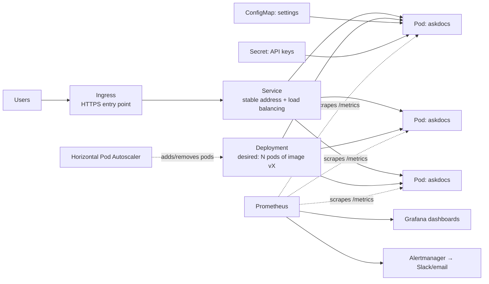

# Module 12C — Kubernetes and SRE Observability for AI [v2]

> Ship · Week 28 · [Syllabus](../SYLLABUS.md#module-12c--kubernetes-and-sre-observability-for-ai-week-28-v2)

**Goal:** run an AI service on Kubernetes the way an SRE would: it scales, it is measured, and it alerts on an SLO.

**Learn after:** 12 Deployment (Docker, tracing) and 12A Cloud AI on AWS (IAM, cloud basics).

## Why Kubernetes?

One Docker container on one machine stops when that machine stops, and it can't handle a sudden spike of users.
**Kubernetes (K8s)** runs many copies of your container across machines. It restarts crashed copies, adds copies
under load and rolls out new versions without downtime. **EKS** is AWS's managed Kubernetes.



## Bricks

| Brick | Topic | Exercise |
|---|---|---|
| 12C.1 | Pod, Deployment, Service, ConfigMap, Secret | Run AskDocs on a local kind/k3d cluster |
| 12C.2 | HPA, Ingress, persistent volumes | Scale on CPU; persist the vector DB |
| 12C.3 | EKS with eksctl, IAM roles for service accounts, Helm | Same app on EKS; pull secrets via an IAM role |
| 12C.4 | Prometheus and PromQL | Expose `/metrics` from FastAPI |
| 12C.5 | Grafana and Alertmanager | Dashboard for p95 latency, error rate, cost per request |
| 12C.6 | Datadog APM and LLM Observability | Compare traces with Phoenix/Langfuse from Module 12 |
| 12C.7 | SLIs, SLOs, error budgets | 99% of answers under 3 s; burn-rate alert |

## 12C.1 Core objects

| Object | Plain meaning |
|---|---|
| **Pod** | One running copy of your container |
| **Deployment** | "Keep N pods of this image running", plus rolling updates |
| **Service** | A stable name and load balancer in front of the pods |
| **ConfigMap** | Non-secret settings (model name, log level) |
| **Secret** | Passwords and API keys |

Start locally with **kind** (Kubernetes in Docker):

```bash
kind create cluster --name ai
kind load docker-image askdocs:latest --name ai      # image built in Module 12
kubectl apply -f k8s/
kubectl get pods -w
kubectl port-forward svc/askdocs 8000:80
```

```yaml
# k8s/app.yaml
apiVersion: v1
kind: ConfigMap
metadata: { name: askdocs-config }
data:
  MODEL: "llama3.2:3b"
  OLLAMA_HOST: "http://ollama:11434"
---
apiVersion: apps/v1
kind: Deployment
metadata: { name: askdocs }
spec:
  replicas: 2
  selector: { matchLabels: { app: askdocs } }
  template:
    metadata: { labels: { app: askdocs } }
    spec:
      containers:
        - name: api
          image: askdocs:latest
          imagePullPolicy: IfNotPresent
          ports: [{ containerPort: 8000 }]
          envFrom: [{ configMapRef: { name: askdocs-config } }]
          env:
            - name: API_KEY
              valueFrom: { secretKeyRef: { name: askdocs-secrets, key: api-key } }
          resources:
            requests: { cpu: "250m", memory: "512Mi" }
            limits: { cpu: "1", memory: "1Gi" }
          readinessProbe: { httpGet: { path: /health, port: 8000 } }     # only send traffic when ready
          livenessProbe: { httpGet: { path: /health, port: 8000 } }      # restart if it hangs
---
apiVersion: v1
kind: Service
metadata: { name: askdocs }
spec:
  selector: { app: askdocs }
  ports: [{ port: 80, targetPort: 8000 }]
```

```bash
kubectl create secret generic askdocs-secrets --from-literal=api-key=dev-secret
```

## 12C.2 Scaling: HPA, Ingress, volumes

```yaml
# k8s/hpa.yaml — add pods when average CPU > 70%, between 2 and 10 pods
apiVersion: autoscaling/v2
kind: HorizontalPodAutoscaler
metadata: { name: askdocs }
spec:
  scaleTargetRef: { apiVersion: apps/v1, kind: Deployment, name: askdocs }
  minReplicas: 2
  maxReplicas: 10
  metrics:
    - type: Resource
      resource: { name: cpu, target: { type: Utilization, averageUtilization: 70 } }
```

The HPA needs the metrics-server add-on. Load-test with the Locust file from Module 12 and watch `kubectl get hpa -w`.
**Ingress** gives a public HTTPS URL. A **PersistentVolumeClaim** keeps vector-DB data when a pod restarts.

LLM services are often limited by the model, not the CPU. When the model runs elsewhere (Bedrock, a GPU node),
scale the API pods on request rate or latency instead, using custom metrics or KEDA.

## 12C.3 EKS

```bash
eksctl create cluster --name ai --region ap-south-1 --nodes 2 --node-type t3.medium
kubectl apply -f k8s/                 # same files as local
eksctl delete cluster --name ai       # delete when done — EKS bills per hour
```

**IAM roles for service accounts (IRSA)** let a pod call Bedrock or read secrets without storing AWS keys in the cluster.
**Helm** packages your YAML files as a reusable chart with settings per environment.

## 12C.4 Prometheus and PromQL

Expose metrics from FastAPI (the [observability demo](../projects/observability-demo/) shows the same pattern):

```python
from prometheus_client import Counter, Histogram, make_asgi_app

REQUESTS = Counter("http_requests_total", "Requests", ["status"])
LATENCY = Histogram("http_request_duration_seconds", "Latency", buckets=[0.5, 1, 2, 3, 5, 10])
app.mount("/metrics", make_asgi_app())
```

Useful PromQL:

```promql
# p95 latency over 5 minutes
histogram_quantile(0.95, sum by (le) (rate(http_request_duration_seconds_bucket[5m])))
# error ratio
sum(rate(http_requests_total{status=~"5.."}[5m])) / sum(rate(http_requests_total[5m]))
```

On Kubernetes, install the **kube-prometheus-stack** Helm chart. It deploys Prometheus, Grafana and Alertmanager together.

## 12C.5 Grafana and Alertmanager

```yaml
# alert rule: error rate above 5% for 5 minutes
groups:
  - name: askdocs
    rules:
      - alert: AskDocsHighErrorRate
        expr: sum(rate(http_requests_total{status=~"5.."}[5m])) / sum(rate(http_requests_total[5m])) > 0.05
        for: 5m
        labels: { severity: page }
        annotations: { summary: "AskDocs error rate above 5% for 5 minutes" }
```

Alertmanager routes alerts to Slack, email or PagerDuty.

## 12C.6 Datadog APM and LLM Observability

Datadog (paid, free trial) combines infrastructure metrics, APM traces and **LLM Observability** (every LLM call
with tokens, cost and latency) in one product. Try it on the trial and compare it with Phoenix or Langfuse.
Many companies already use Datadog, which makes it worth knowing.

## 12C.7 SLIs, SLOs and error budgets

| Term | Plain meaning | AskDocs example |
|---|---|---|
| **SLI** (indicator) | What you measure | % of answers returned in under 3 s |
| **SLO** (objective) | Your target | 99% of answers under 3 s over 30 days |
| **Error budget** | Allowed failures | 1% of requests may be slow; once it's used up, freeze risky releases |
| **Burn rate** | How fast you spend the budget | 14× normal burn over 1 hour → page someone |

AI-specific SLIs to add: % of answers with a citation, groundedness score above a threshold, and cost per request under budget.

## Build — AI on EKS

Deploy AskDocs to Kubernetes (kind first, then EKS) with an HPA, a Grafana dashboard and an SLO burn-rate alert.

**Checkpoint:** the service scales under a Locust load test, the alert fires on a planted error spike, and the EKS cluster
is deleted afterwards.
