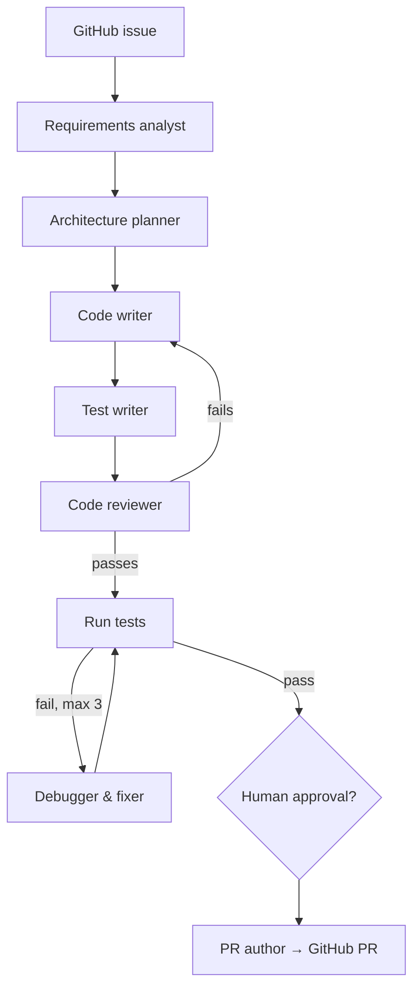

# Module 15 — Bonus Capstone: Autonomous Software-Engineering Agent [v2]

> Bonus · 12 weeks after Module 14 (optional) · [Syllabus](../SYLLABUS.md#module-15--bonus-capstone-autonomous-software-engineering-agent-12-weeks-optional-v2)

**Goal:** a LangGraph system that takes a GitHub issue to an opened pull request, with tests, review and a human gate.

**Learn after:** 13A Coding Agents, 13 Capstone and 14 Interview Sprint. It reuses MCP (11), LangGraph (9),
Reflexion (8.13), episodic memory (8.11), pgvector (4.13), FastAPI SSE (1.10) and EKS (12C).

## Flow

## 12-week plan

| Weeks | Focus | Milestone |
|---|---|---|
| 1–2 | Tooling | GitHub, filesystem and subprocess MCP servers callable from one LangGraph node |
| 3–4 | Codebase RAG | Chunk code by function, embed into pgvector, semantic code search works |
| 5–6 | Agents 1–4 | Analyst, planner, writer, test writer pass an "add a utility function" task |
| 7–8 | Review and debug loop | Reviewer + Reflexion fixer recover deliberately broken code |
| 9 | Orchestration | All 7 agents wired with the approval gate; real issue on a toy repo |
| 10 | API | FastAPI `POST /engineer` streams progress over SSE |
| 11 | Observability and safety | Prometheus/Grafana metrics; guardrails block `shell=True`, `os.system()`, hardcoded secrets |
| 12 | Portfolio | 15-minute demo video, blog post, public repo |

**Checkpoint:** test pass rate and review findings per run; one unsafe-code attempt blocked.
