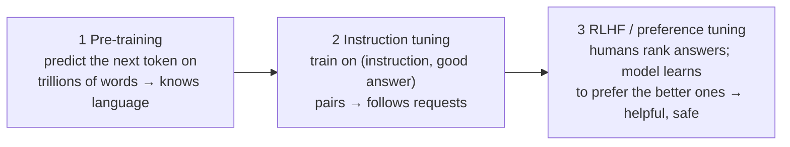
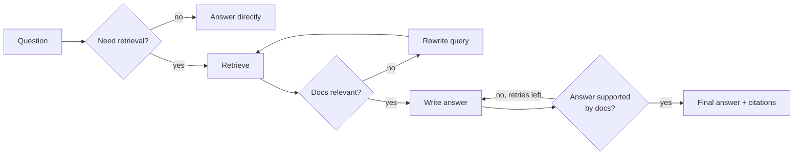
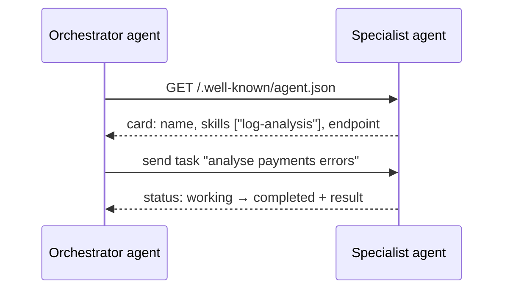
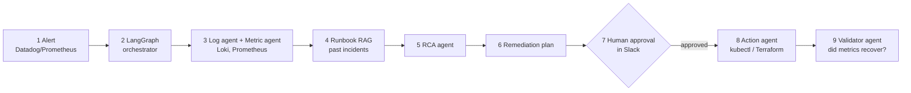

# Study Guide for the [v2] Topics

The topics tagged **[v2]** in [SYLLABUS.md](../SYLLABUS.md) come from the *12-Month AI & Agentic AI Complete Learning Syllabus*
(v2). This guide explains each one in plain words, **in the order you learn it**. Every topic has five parts:

- **Learn after:** what you must know first
- **What it is:** one-paragraph explanation
- **Why it matters:** where you will use it in this course
- **Try it:** a small example you can run
- **Done when:** how you know you can move on

Use it alongside the module notes. When you reach a [v2] brick in a module, read its section here.

```mermaid
flowchart TB
    subgraph B["Basics"]
        A1[1.0 Python from zero] --> A2[1.10 FastAPI streaming & auth]
        A2 --> A3[1A.0a NumPy] --> A4[1A.0b Pandas] --> A5[1A.0c Statistics] --> A6[1A.8 scikit-learn] --> A7[1A.9 PyTorch loop]
    end
    subgraph L["LLMs"]
        B1[2.3 See attention: BertViz] --> B2[2.12 Hugging Face hands-on] --> B3[2.13 How LLMs are trained] --> B4[2.14 Hallucination & benchmarks]
    end
    subgraph R["RAG"]
        C1[4.2 Embeddings in 2D: PCA] --> C2[4.13 pgvector, Pinecone, loaders] --> C3[4.14 LangChain LCEL] --> C4[5.12 Self-RAG]
    end
    subgraph G["Agents"]
        D1[8.11 Memory types] --> D2[8.12 Parallel tools] --> D3[8.13 Reasoning patterns] --> D4[9.7 LangSmith] --> D5[10.6 A2A lab] --> D6[10.7 CrewAI] --> D7[10.8 AutoGen]
    end
    subgraph P["Production"]
        E1[11.2 MCP security] --> E2[12.10 Docker Compose] --> E3[12.11 LLMOps & MLflow] --> E4[12A Bedrock Agents, Pipelines, IAM] --> E5[12C Kubernetes & SRE] --> E6[13.11 AIOps capstone] --> E7[15 SWE agent]
    end
    A7 --> B1
    B4 --> C1
    C4 --> D1
    D7 --> E1
```



---

## Basics

### 1.0 Python from zero

- **Learn after:** nothing. This is the very start.
- **What it is:** the core language: variables, lists and dictionaries, `if`/`for`, functions, reading files, handling errors, and classes.
- **Why it matters:** every AI library (PyTorch, LangChain, CrewAI) is Python, and agent frameworks are built from classes.
- **Try it:**

```python
class BaseTool:
    def __init__(self, name: str):
        self.name = name

    def run(self, text: str) -> str:
        raise NotImplementedError


class CalculatorTool(BaseTool):
    def run(self, text: str) -> str:
        a, op, b = text.split()
        return str({"+": float(a) + float(b), "*": float(a) * float(b)}[op])


class WordCountTool(BaseTool):
    def run(self, text: str) -> str:
        return str(len(text.split()))


for tool in [CalculatorTool("calc"), WordCountTool("words")]:
    try:
        print(tool.name, "→", tool.run("12 * 3"))
    except Exception as e:
        print(tool.name, "failed:", e)
```

- **Done when:** you can write a class that inherits from another, read a JSON file, and handle an error with `try/except`. If any of this is new, do Harvard **CS50P** (free) before Module 1.

### 1.10 FastAPI beyond basics: streaming and authentication

- **Learn after:** 1.7 FastAPI basics.
- **What it is:** two production features. **Server-Sent Events (SSE)** send an LLM's answer word by word instead of all at once. **API keys** (or OAuth2/JWT) stop strangers from calling your service.
- **Why it matters:** chat UIs feel instant with streaming, and every deployed AI endpoint needs authentication (Modules 12, 15).
- **Try it:**

```python
# uv add fastapi uvicorn ollama ;  run: uv run uvicorn stream_app:app
import os
import ollama
from fastapi import FastAPI, Header, HTTPException
from fastapi.responses import StreamingResponse

app = FastAPI()
API_KEY = os.getenv("API_KEY", "dev-secret")

@app.get("/ask")
def ask(q: str, x_api_key: str = Header(default="")):
    if x_api_key != API_KEY:
        raise HTTPException(status_code=401, detail="bad API key")

    def events():
        for part in ollama.chat(model="llama3.2:3b", messages=[{"role": "user", "content": q}], stream=True):
            yield f"data: {part.message.content}\n\n"     # SSE format: "data: ...\n\n"
        yield "data: [DONE]\n\n"

    return StreamingResponse(events(), media_type="text/event-stream")
```

```bash
curl -N -H "x-api-key: dev-secret" "localhost:8000/ask?q=What%20is%20RAG"
```

- **Done when:** words appear one by one in `curl`, and a wrong key returns 401.

### 1A.0a NumPy: numbers at scale

- **Learn after:** 1.0 Python.
- **What it is:** fast arrays of numbers. A neural network is mostly big arrays multiplied together.
- **Why it matters:** embeddings are NumPy arrays; cosine similarity in RAG is one NumPy line.
- **Try it:**

```python
import numpy as np

scores = np.random.default_rng(0).integers(0, 101, size=500)   # 500 students
print(scores.mean().round(1), scores.max(), scores.shape)
top10 = np.sort(scores)[-50:]                                 # top 10%
print("top 10% cut-off:", top10.min())

A = np.array([[1, 2], [3, 4]]); B = np.array([[5], [6]])
print(A @ B)                     # matrix multiplication (the dot product)
print(A * 10)                    # broadcasting: 10 applied to every element
```

- **Done when:** you can explain array shape `(2, 2)` vs `(2, 1)` and do a dot product.

### 1A.0b Pandas: tables of data

- **Learn after:** NumPy.
- **What it is:** a DataFrame, like an Excel sheet inside Python.
- **Why it matters:** real data (logs, tickets, evaluation results) arrives as messy tables. You will use Pandas to analyse eval results in Module 3.
- **Try it:**

```python
import pandas as pd

logs = pd.DataFrame({
    "service": ["payments", "payments", "auth", "auth", "search"],
    "severity": ["P1", "P2", "P1", None, "P3"],
    "minutes_to_fix": [42, 15, 30, 8, None],
})
logs.info()                                                    # column types and missing values
logs["severity"] = logs["severity"].fillna("unknown")          # handle missing values
logs["minutes_to_fix"] = logs["minutes_to_fix"].fillna(logs["minutes_to_fix"].median())
print(logs.groupby("severity")["minutes_to_fix"].agg(["count", "mean"]))
```

- **Done when:** you can load a CSV, fill missing values and group by a column.

### 1A.0c Statistics for ML

- **Learn after:** Pandas.
- **What it is:** describing data and judging confidence: mean vs median, spread (standard deviation), the bell curve, correlation.
- **Why it matters:** every metric you report (latency p95, accuracy, judge scores) is statistics. **Correlation is not causation:** a prompt change and a better score may be coincidence.
- **Try it:**

```python
import numpy as np

latency_ms = np.array([120, 130, 125, 118, 900, 122, 127])      # one slow outlier
print("mean", latency_ms.mean().round(), "median", np.median(latency_ms), "p95", np.percentile(latency_ms, 95))

hours_studied = np.array([1, 2, 3, 4, 5]); score = np.array([50, 55, 65, 70, 80])
print("correlation", np.corrcoef(hours_studied, score)[0, 1].round(2))
```

- **Done when:** you can explain why the median and p95 tell you more about latency than the mean.

### 1A.8 Classical ML with scikit-learn

- **Learn after:** 1A.1–1A.4 (what ML is, metrics).
- **What it is:** ready-made algorithms with the same three methods: `fit` (learn), `predict`, `score`.
- **Why it matters:** many business problems are solved better and cheaper by a small model than by an LLM. It also teaches the train/test habit you use for every eval.
- **Try it:**

```python
from sklearn.datasets import load_iris
from sklearn.ensemble import RandomForestClassifier
from sklearn.linear_model import LogisticRegression
from sklearn.model_selection import cross_val_score

X, y = load_iris(return_X_y=True)
for model in (LogisticRegression(max_iter=500), RandomForestClassifier(random_state=0)):
    scores = cross_val_score(model, X, y, cv=5)                 # 5-fold cross-validation
    print(type(model).__name__, round(scores.mean(), 3))
```

- **Done when:** you can train two models, compare them with cross-validation, and read a confusion matrix.

### 1A.9 PyTorch hands-on: the training loop

- **Learn after:** 1A.5 neural networks.
- **What it is:** the five-line loop that trains every neural network, from a tiny classifier to an LLM: **zero_grad → forward → loss → backward → step**.
- **Why it matters:** fine-tuning in Module 7 is this same loop, wrapped by a library.
- **Try it:**

```python
import torch
from torch import nn

X = torch.linspace(-2, 2, 200).unsqueeze(1); y = X ** 2               # learn y = x²
model = nn.Sequential(nn.Linear(1, 32), nn.ReLU(), nn.Linear(32, 1))
opt = torch.optim.Adam(model.parameters(), lr=0.01)

for epoch in range(300):
    opt.zero_grad()                          # 1. clear old gradients
    pred = model(X)                          # 2. forward pass
    loss = nn.functional.mse_loss(pred, y)   # 3. how wrong?
    loss.backward()                          # 4. gradients (backpropagation)
    opt.step()                               # 5. update weights
    if epoch % 100 == 0:
        print(epoch, round(loss.item(), 4))

torch.save(model.state_dict(), "square.pt")              # save
model.load_state_dict(torch.load("square.pt"))           # load
print(model(torch.tensor([[1.5]])).item())               # ≈ 2.25
```

- **Done when:** you can write this loop from memory and explain each of the five steps.

---

## LLMs

### 2.3 See attention with BertViz

- **Learn after:** 2.3 the Transformer.
- **What it is:** a notebook tool that draws which words each word "looks at".
- **Why it matters:** seeing attention once makes the idea concrete.
- **Try it (in Jupyter):**

```python
# uv add bertviz transformers torch jupyter ; run inside a notebook
from bertviz import head_view
from transformers import AutoModel, AutoTokenizer

tok = AutoTokenizer.from_pretrained("bert-base-uncased")
model = AutoModel.from_pretrained("bert-base-uncased", output_attentions=True)
inputs = tok("The cat sat on the mat because it was tired", return_tensors="pt")
attention = model(**inputs).attentions
head_view(attention, tok.convert_ids_to_tokens(inputs["input_ids"][0]))
```

- **Done when:** you find a head where "it" attends strongly to "cat".

### 2.12 Hugging Face hands-on

- **Learn after:** 2.5 model ecosystem.
- **What it is:** the Hub (models, datasets, demos) plus the `transformers` library. **Pipelines** run a model in a few lines; **AutoTokenizer/AutoModel** load any model.
- **Architectures:** *encoder* models (BERT) understand text (classification, embeddings); *decoder* models (GPT, Llama) generate text; *encoder-decoder* models (T5) transform text (translation, summarisation).
- **Try it:**

```python
from transformers import pipeline

sentiment = pipeline("sentiment-analysis")                          # encoder model
print(sentiment(["The refund was quick!", "Support never replied."]))

generator = pipeline("text-generation", model="gpt2")               # decoder model
print(generator("RAG stands for", max_new_tokens=20)[0]["generated_text"])
```

- **Next steps:** compare three models on the same classification task; deploy one as a free Gradio demo on **Hugging Face Spaces**.
- **Done when:** you can load a model by name and read its model card (licence, training data, limits).

### 2.13 How LLMs are trained

- **Learn after:** 1A.9 training loop and 2.3 the Transformer.
- **What it is:** three stages.



- **Why it matters:** it explains why base models ramble, why chat models follow instructions, and why fine-tuning (Module 7, including DPO, a simpler form of stage 3) works.
- **Done when:** you can explain the three stages to a friend in under two minutes.

### 2.14 Hallucination and benchmarks

- **Learn after:** 2.13.
- **What it is:** a **hallucination** is a confident, wrong answer. The model predicts *likely* text, not *true* text. **Benchmarks** (MMLU, GPQA, SWE-bench, LMArena) are standard tests used to compare models.
- **Why it matters:** RAG (Modules 4–5), citations and evals exist to fight hallucination. Benchmarks help shortlist models, but your own eval decides.
- **Try it:** ask a small local model *"Who won the 2031 Nobel Prize in Physics?"* or about a made-up person. Then add *"If you don't know, say so"* and compare.
- **Reading benchmarks:** check what the test measures, whether it matches your task, and the date. Treat leaderboards as a starting shortlist only.
- **Done when:** you have triggered one hallucination and written down two mitigations.

---

## RAG

### 4.2 See embeddings in 2D with PCA

- **Learn after:** 4.2 embedding models.
- **What it is:** embeddings have hundreds of dimensions. **PCA** squashes them to 2 so you can plot them and *see* similar sentences cluster.
- **Try it:**

```python
# uv add ollama scikit-learn matplotlib
import matplotlib.pyplot as plt
import ollama
from sklearn.decomposition import PCA

sentences = ["UPI refund delayed", "money not credited back", "reset my password",
             "can't log in", "pizza recipe", "how to bake bread"]
vecs = ollama.embed(model="nomic-embed-text", input=sentences).embeddings
xy = PCA(n_components=2).fit_transform(vecs)
plt.scatter(xy[:, 0], xy[:, 1])
for (x, y), s in zip(xy, sentences):
    plt.annotate(s, (x, y))
plt.savefig("embeddings.png")
```

- **Done when:** your plot shows three clusters: payments, login and cooking.

### 4.13 More vector stores and sources: pgvector, Pinecone, loaders

- **Learn after:** 4.5 vector databases.
- **What it is:** **pgvector** adds vector search to PostgreSQL, so you can keep vectors next to your normal data. **Pinecone** is a fully managed cloud vector DB. **Loaders** pull documents from Confluence, Slack, Notion and other sources.
- **Try it (pgvector with Docker):**

```bash
docker run -d --name pgv -e POSTGRES_PASSWORD=pw -p 5432:5432 pgvector/pgvector:pg16
```

```python
# uv add "psycopg[binary]" ollama
import ollama
import psycopg

docs = ["UPI refunds take 3-5 working days.", "Passwords reset from Settings."]
vecs = ollama.embed(model="nomic-embed-text", input=docs).embeddings
with psycopg.connect("postgresql://postgres:pw@localhost:5432/postgres", autocommit=True) as db:
    db.execute("CREATE EXTENSION IF NOT EXISTS vector")
    db.execute("CREATE TABLE IF NOT EXISTS chunks (id serial PRIMARY KEY, text text, emb vector(768))")
    for d, v in zip(docs, vecs):
        db.execute("INSERT INTO chunks (text, emb) VALUES (%s, %s::vector)", (d, str(v)))
    q = ollama.embed(model="nomic-embed-text", input=["refund time"]).embeddings[0]
    print(db.execute("SELECT text FROM chunks ORDER BY emb <=> %s::vector LIMIT 1", (str(q),)).fetchone())
```

`<=>` is cosine distance in pgvector.

| Store | Pick it when |
|---|---|
| Chroma / FAISS | Learning, local prototypes |
| pgvector | You already run Postgres; want SQL filters + vectors together |
| Qdrant | Dedicated vector DB, self-hosted or cloud |
| Pinecone | Fully managed, zero ops |

- **Done when:** the same query returns the right chunk from pgvector and from Chroma.

### 4.14 LangChain in depth: LCEL

- **Learn after:** 4.12 frameworks and a working Mini-RAG.
- **What it is:** **LCEL** (LangChain Expression Language) joins steps with `|`, like a Unix pipe: prompt | model | parser.
- **Try it:**

```python
# uv add langchain-core langchain-ollama
from langchain_core.output_parsers import StrOutputParser
from langchain_core.prompts import ChatPromptTemplate
from langchain_core.runnables import RunnablePassthrough
from langchain_ollama import ChatOllama

def retrieve(question: str) -> str:              # plug in your Mini-RAG retriever here
    return "UPI refunds take 3-5 working days."

prompt = ChatPromptTemplate.from_messages([
    ("system", "Answer only from the context. Context: {context}"),
    ("human", "{question}"),
])
chain = {"context": retrieve, "question": RunnablePassthrough()} | prompt | ChatOllama(model="llama3.2:3b") | StrOutputParser()
print(chain.invoke("How long do UPI refunds take?"))
```

**Output parsers** turn model text into a Pydantic object (`PydanticOutputParser`) or JSON. **Memory** keeps chat history (`RunnableWithMessageHistory`).

- **Done when:** you rebuild your Mini-RAG answer step as one LCEL chain.

### 5.12 Self-RAG

- **Learn after:** 5.7 agentic RAG.
- **What it is:** the model decides **whether** to retrieve, then **grades** the documents and its own answer, and retries if the answer is not supported.



- **Why it matters:** fewer wasted retrievals and fewer unsupported answers. It is easy to build as a LangGraph graph (Module 9).
- **Done when:** your graph rewrites a bad query at least once on a test question and still answers correctly.

---

## Agents

### 8.11 Memory types

- **Learn after:** 8.6 memory and context.

| Type | Human analogy | Agent example | Store |
|---|---|---|---|
| In-context | What you are thinking now | Current `messages` list | Prompt |
| Episodic | "Last Tuesday I…" | Past incidents and how they were fixed | Vector DB with timestamps |
| Semantic | Facts you know | "User prefers Hindi", "service X owns payments" | Key-value or vector DB |
| Procedural | How to ride a bike | System prompt, tools, runbooks | Prompt and code |

**Retrieval score** = recency + relevance + importance (each 0–1, weighted). Old memories get **summarised** so they fit.

```python
import math, time

def memory_score(mem: dict, query_similarity: float, now: float | None = None) -> float:
    hours_old = ((now or time.time()) - mem["timestamp"]) / 3600
    recency = math.exp(-hours_old / 24)            # fades over about a day
    return 0.3 * recency + 0.5 * query_similarity + 0.2 * mem["importance"]
```

- **Done when:** your agent recalls a fact you told it in a previous session.

### 8.12 Parallel tool calling and tool errors

- **Learn after:** 8.3 tool calling.
- **What it is:** the model can request **several tools in one turn** (weather *and* news). Run them at the same time and return every result. If one fails, return its error as text so the model can recover.
- **Try it:**

```python
import asyncio

async def run_tools_in_parallel(calls, tools: dict) -> list[dict]:
    async def one(call):
        try:
            result = await asyncio.wait_for(asyncio.to_thread(tools[call.function.name], **call.function.arguments), 10)
        except Exception as e:                      # timeout, bad args, API down
            result = f"ERROR in {call.function.name}: {e}"
        return {"role": "tool", "tool_name": call.function.name, "content": str(result)}
    return await asyncio.gather(*(one(c) for c in calls))
```

- **Done when:** two tool calls in one turn finish in about the time of the slower one, and a failing tool doesn't crash the agent.

### 8.13 Reasoning patterns compared

- **Learn after:** 8.4 planning loops.

| Pattern | How it works | Best for | Cost |
|---|---|---|---|
| ReAct | Think → act → observe, repeat | Most tool-using tasks | Low |
| Plan-and-Execute | Write a full plan, then do each step | Long multi-step tasks | Medium |
| Reflexion | Try → critique own result → retry with lessons | Code, tasks with a clear pass/fail check | Medium–high |
| Tree of Thoughts | Explore several reasoning branches, score them, keep the best | Puzzles, planning with dead ends | High |
| Self-consistency | Ask the same question several times, take the majority answer | Maths and short factual answers | ×N calls |

```python
from collections import Counter
import ollama

def self_consistent(question: str, n: int = 5) -> str:
    answers = [ollama.chat(model="llama3.2:3b", options={"temperature": 0.8},
               messages=[{"role": "user", "content": question + " Reply with the final number only."}]).message.content.strip()
               for _ in range(n)]
    return Counter(answers).most_common(1)[0][0]

print(self_consistent("A shop sells 3 pens for ₹20. How much do 12 pens cost?"))
```

- **Decision rule:** start with ReAct. Add Plan-and-Execute for long tasks, Reflexion when you can automatically check results, and self-consistency for short answers where accuracy matters more than cost.
- **Done when:** you have run ReAct vs Reflexion on the same task and compared success rate and tokens.

### 9.7 LangSmith

- **Learn after:** 9.6 evaluating and tracing agents.
- **What it is:** LangChain's hosted tracing and evaluation tool (free developer tier). Two environment variables trace every LangChain/LangGraph run.

```dotenv
LANGSMITH_TRACING=true
LANGSMITH_API_KEY=lsv2_...
LANGSMITH_PROJECT=rag-agents-masterclass
```

- **Compare:** Phoenix (local, open source; see the [observability guide](observability-guide.md)) vs Langfuse (open source, self-host) vs LangSmith (hosted, deepest LangGraph integration). Learn one well; the concepts transfer.
- **Done when:** you can open one agent run and find the slowest step and the most expensive LLM call.

### 10.6 A2A lab: discovery and delegation

- **Learn after:** 10.6 agent protocols (concepts).
- **What it is:** each A2A agent publishes an **agent card**, a JSON file at `/.well-known/agent.json` describing its skills. Another agent reads the card, then sends a task.



- **Try it:** build two FastAPI services. One serves an agent card and a `/tasks` endpoint; the other reads the card and delegates. Then repeat with the official A2A SDK.
- **Done when:** the orchestrator finds the specialist by skill, not by a hard-coded URL.

### 10.7 CrewAI in depth

- **Learn after:** 10.1 architectures (the crew example in Module 10 notes).
- **Core ideas:** **Agent** (role, goal, tools) · **Task** (description, expected output, agent) · **Crew** (agents + tasks + process) · **Tool**.
- **Process:** *sequential* runs tasks in order; *hierarchical* adds a manager agent that delegates.
- **Memory:** `Crew(..., memory=True)` gives short-term, long-term and entity memory.
- **Lab:** an SRE crew with Log Analyser, Metric Checker and Runbook Retriever agents, plus a human-approval step before any "remediation" task (`human_input=True` on that task).
- **Done when:** you can explain when to pick CrewAI (role-based teams, fast prototypes) vs LangGraph (exact control flow).

### 10.8 AutoGen

- **Learn after:** 10.7 CrewAI.
- **What it is:** Microsoft's framework where agents **talk to each other** until a stop condition. `AssistantAgent` is an LLM agent; `UserProxyAgent` stands in for a human or runs code; **GroupChat** puts several agents at one table.

```python
# uv add "autogen-agentchat" "autogen-ext[ollama]"
import asyncio
from autogen_agentchat.agents import AssistantAgent
from autogen_agentchat.conditions import TextMentionTermination
from autogen_agentchat.teams import RoundRobinGroupChat
from autogen_ext.models.ollama import OllamaChatCompletionClient

model = OllamaChatCompletionClient(model="qwen2.5:7b")
writer = AssistantAgent("writer", model_client=model, system_message="Write Python code for the task.")
reviewer = AssistantAgent("reviewer", model_client=model,
                          system_message="Review the code. Say APPROVED when it is correct, otherwise list fixes.")
team = RoundRobinGroupChat([writer, reviewer], termination_condition=TextMentionTermination("APPROVED"))

asyncio.run(team.run(task="Write a function is_palindrome(s) that ignores case and spaces."))
```

AutoGen's API changed a lot between v0.2 and v0.4+. The code above uses the newer `autogen-agentchat` style.

- **When to use which:** AutoGen for debates and code generation with review; CrewAI for role-based pipelines; LangGraph for production workflows with exact control.
- **Done when:** your writer–reviewer pair converges in under 5 rounds.

---

## Production

### 11.2 MCP security: authentication, rate limiting, input validation

- **Learn after:** 11.2 building an MCP server.
- **What it is:** three gates in front of every tool call.

```python
import time
from collections import defaultdict, deque

API_KEYS = {"key-team-a": "team-a"}                       # in production: OAuth tokens (11.3)
calls: dict[str, deque] = defaultdict(deque)

def guard(api_key: str, limit_per_minute: int = 30) -> str:
    client = API_KEYS.get(api_key)
    if client is None:
        raise PermissionError("unknown client")            # 1. authentication
    now, window = time.time(), calls[client]
    while window and now - window[0] > 60:
        window.popleft()
    if len(window) >= limit_per_minute:
        raise RuntimeError("rate limit exceeded")          # 2. rate limiting
    window.append(now)
    return client
# 3. input validation: typed arguments + allow-lists inside each tool (see Module 11 notes)
```

- **Done when:** a 31st call within a minute is rejected and an unknown key is refused.

### 12.10 Docker in depth: multi-stage builds and Compose

- **Learn after:** 12.2 packaging.
- **Multi-stage build:** build in one image, copy only the result into a small final image, so images are smaller and safer.

```dockerfile
FROM python:3.11-slim AS build
COPY --from=ghcr.io/astral-sh/uv:latest /uv /usr/local/bin/uv
WORKDIR /app
COPY pyproject.toml uv.lock ./
RUN uv sync --frozen --no-dev

FROM python:3.11-slim
WORKDIR /app
COPY --from=build /app/.venv /app/.venv
COPY src ./src
ENV PATH="/app/.venv/bin:$PATH"
CMD ["uvicorn", "src.app:app", "--host", "0.0.0.0", "--port", "8000"]
```

- **Compose:** run agent + vector DB + Redis together with one command. See the `docker-compose.yml` in Module 12 notes; add a `redis:7` service.
- **Done when:** `docker compose up` starts all services and `docker images` shows a smaller image than your single-stage build.

### 12.11 LLMOps: experiment tracking, A/B tests, registry, SLAs

- **Learn after:** 12.3 CI/CD with eval gates.
- **What it is:** treating prompts and models like releases: track every experiment, compare versions, register what is in production, and promise latency (SLA).
- **Try it (MLflow, local):**

```python
# uv add mlflow ;  view: uv run mlflow ui → http://localhost:5000
import mlflow

for prompt_version, accuracy, p95 in [("v1", 0.78, 2.1), ("v2", 0.86, 2.4)]:   # from your eval runs
    with mlflow.start_run(run_name=f"prompt-{prompt_version}"):
        mlflow.log_params({"prompt_version": prompt_version, "model": "llama3.2:3b"})
        mlflow.log_metrics({"accuracy": accuracy, "p95_latency_s": p95})
```

- **A/B test:** send 10% of traffic to prompt v2, compare quality and cost on real traffic, then promote or roll back.
- **Done when:** you can show which prompt version is live and why it won.

### 12A Bedrock Agents, SageMaker Pipelines and IAM least privilege

- **Learn after:** 12A.2–12A.4.
- **Bedrock Agents:** AWS's managed agent. You define instructions, action groups (tools backed by Lambda) and a knowledge base. Compare it with your own LangGraph agent.
- **SageMaker Pipelines:** an automated chain (prepare data → train → evaluate → register model). **Model Monitor** watches a live endpoint for data drift.
- **IAM least privilege:** give each service only the permissions it needs.

```json
{
  "Version": "2012-10-17",
  "Statement": [{
    "Effect": "Allow",
    "Action": ["bedrock:InvokeModel", "bedrock:InvokeModelWithResponseStream"],
    "Resource": "arn:aws:bedrock:us-east-1::foundation-model/<your-model-id>"
  }]
}
```

- **Done when:** your app's IAM role can call exactly one model and nothing else.

### 12C Kubernetes and SRE observability

Full module: [12c-kubernetes-and-sre-observability.md](12c-kubernetes-and-sre-observability.md).
In short: run your service on Kubernetes so it scales and heals itself, then measure it with Prometheus and Grafana, and
promise reliability with SLOs.

### 13.11 Capstone option: Agentic AI SRE / AIOps platform

- **Learn after:** everything up to 12C.



- **Six-week plan:** architecture and setup → runbook RAG → core agents → LangGraph wiring with approval → hardening (guardrails, evals, metrics) → demo and README.
- **Done when:** a planted incident (e.g. a crashing pod) goes from alert to approved fix to verified recovery.

### 15 Bonus: Autonomous software-engineering agent

Full module: [15-autonomous-swe-agent.md](15-autonomous-swe-agent.md). Seven agents take a GitHub issue to a pull
request. Do it after the capstone, as a 12-week stretch project.
